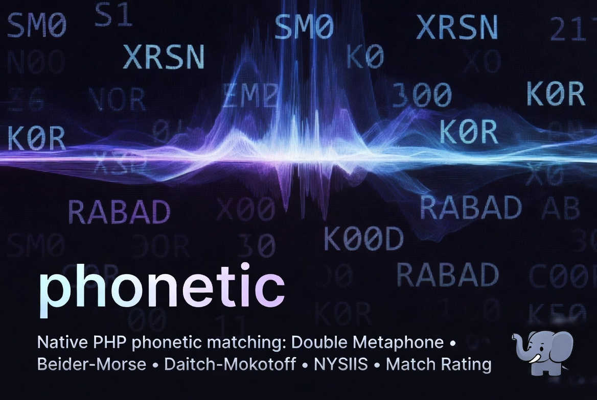

# phonetic

Native phonetic name matching for PHP: Double Metaphone, Beider-Morse Phonetic Matching (BMPM), Daitch-Mokotoff Soundex, NYSIIS, and Match Rating Approach. PHP core ships only `soundex()` and `metaphone()`; these are the encoders used for fuzzy name matching, record linkage, and genealogy search across spelling and transliteration variants. Comparison helpers answer "do these two names sound alike?" directly.



## Quick start

Install via [PIE](https://github.com/php/pie) (requires PHP 8.1 or later):

```sh
pie install iliaal/phonetic
```

Then check whether two names sound alike:

```php
double_metaphone_match("Catherine", "Kathryn");   // 2  (strong match)
dm_soundex_match("Moskowitz", "Moskovitz");        // true
bmpm_match("Peterson", "Petersen");                // true
```

## Choosing an algorithm

| | Double Metaphone | BMPM | Daitch-Mokotoff Soundex | NYSIIS | Match Rating |
|---|---|---|---|---|---|
| Output | primary + alternate key | language-aware token set | distinct 6-digit codes | single key | compact codex |
| Two names match when | keys are equal | token sets intersect | code sets intersect | keys are equal | clear the MRA similarity threshold |
| Strongest for | English and general Latin-script names | cross-language and transliteration variants (Slavic, Germanic, Hebrew, Romance) | Eastern-European and Ashkenazi surnames, genealogy | American/English surnames | English names; ships its own similarity test |
| Spelling-variant recall | good | highest | high, within its language model | good | good |
| Ambiguity handling | up to 2 keys | many tokens | multiple codes | single key | single codex |
| Relative speed | fast (1.0x) | slowest (~60x) | middle (~2.3x) | fast (0.42x) | fastest (0.24x) |
| Data source | clean-room published algorithm | Apache Commons Codec rule data | Apache Commons Codec rule data | clean-room published algorithm | clean-room published algorithm |

Use Double Metaphone as a fast general-purpose default, BMPM when names cross languages or scripts, and Daitch-Mokotoff for Eastern-European and Jewish genealogy, where it is the field standard. NYSIIS and Match Rating Approach are lighter single-key English/American encoders, useful as alternate index keys or as a second check alongside Double Metaphone.

## API

### Double Metaphone

Primary + alternate phonetic keys (Lawrence Philips). Clean-room implementation.

```php
double_metaphone(string $string, int $max_length = 4): array

double_metaphone("Schwarzenegger");        // ['primary' => 'XRSN', 'alternate' => 'XFRT']
double_metaphone("Smith");                 // ['primary' => 'SM0',  'alternate' => 'XMT']
double_metaphone("Catherine", 3);          // ['primary' => 'K0R',  'alternate' => 'KTR']
```

`alternate` equals `primary` when the algorithm produced no alternate branch. `max_length` caps each key (default 4; `0` or negative = unlimited).

### Beider-Morse Phonetic Matching

Language-aware token set. `|` separates alternatives. With the default
concatenation mode, ordinary words form one encoded sequence (`"John Smith"`
becomes `"ionzmit"`). Recognized generic prefixes use
`(remainder)-(combined)` groups. Matches Apache Commons Codec's default
`BeiderMorseEncoder`.

```php
bmpm(string $string, int $name_type = BMPM_GENERIC, int $accuracy = BMPM_APPROX, string $language = ""): string

bmpm("Jackson");                           // "iakson|iaksun|...|zokson"
bmpm("Garcia", BMPM_SEPHARDIC, BMPM_EXACT);// "garsia|gartSa"
```

Empty `$language` auto-detects. To force a language, pass its exact lowercase
token for that name type (e.g. `"russian"`, `"english"`). Tokens are
name-type-specific (GENERIC has the largest set; ASHKENAZI/SEPHARDIC are
subsets). You can't force the label `"any"`; see Notes.

Constants (numeric values):

| Constant | Value | Role |
|---|---|---|
| `BMPM_GENERIC` | 0 | name type |
| `BMPM_ASHKENAZI` | 1 | name type |
| `BMPM_SEPHARDIC` | 2 | name type |
| `BMPM_APPROX` | 10 | accuracy |
| `BMPM_EXACT` | 20 | accuracy |

Accuracy values don't overlap name-type values, so a misplaced constant such as `bmpm($s, BMPM_APPROX)` is rejected instead of selecting a name type. Use the constant names, not integers.

Invalid `$name_type`, `$accuracy`, or unknown `$language` for the name type raise `ValueError`. Inputs longer than 4096 bytes and resource-budget overruns also raise `ValueError` (bounds shared with `bmpm_match()`; see [Notes and limitations](#notes-and-limitations)).

A forced language also applies to the split variants of prefixed names (`van Smith`, `d'Angelo`). This differs from Commons Codec, which re-detects the language inside its prefix branch and ignores the forced set there.

### Daitch-Mokotoff Soundex

List of distinct 6-digit codes (the algorithm branches on ambiguous letters). Uses Apache Commons Codec's `DaitchMokotoffSoundex` branching rules, with the resource limits described in [Notes and limitations](#notes-and-limitations).

```php
dm_soundex(string $string): array

dm_soundex("Auerbach");                    // ['097400', '097500']
dm_soundex("Peters");                      // ['734000', '739400']
dm_soundex("");                            // []  (API: empty list, not ["000000"])
```

For an empty string, this API returns `[]` instead of Commons Codec's `["000000"]`. Non-empty input that matches no rule still returns `["000000"]` for encoder parity with the oracle. Inputs over 4096 bytes or encodings that exceed the work budget throw `ValueError`.

Indexing caveat: `"000000"` is also the finished code for pure-vowel inputs that did match a rule (e.g. `"A"`), so two `"000000"` encodings don't imply a match. `dm_soundex_match("A", "1")` is `false` although both encode to `["000000"]`. When you build an inverted index from `dm_soundex()`, skip the `"000000"` key or use `dm_soundex_match()` at query time.

### NYSIIS

Single phonetic key (New York State Identification and Intelligence System), tuned for American/English surnames. Reimplementation of the published algorithm; matches Apache Commons Codec's `Nysiis`.

```php
nysiis(string $string, int $max_length = 6): string

nysiis("Larson");                          // "LARSAN"
nysiis("Larsen");                          // "LARSAN"  (same key)
nysiis("Macdonald", 0);                    // "MCDANALD"  (full, untruncated)
```

The classic algorithm truncates to 6 characters; `max_length = 0` (or negative) returns the full key.

### Match Rating Approach

Compact codex (Western Airlines, 1977). Pair it with its own similarity test instead of comparing codexes for equality.

```php
match_rating(string $string): string

match_rating("Smith");                     // "SMTH"
match_rating("Catherine");                 // "CTHRN"
```

Use `match_rating_compare()` (below) to decide whether two names match. It applies the algorithm's length and rating rules, which codex equality skips.

## Comparison helpers

Each encoder returns a different output shape, so each needs its own comparison. These helpers implement it, so you don't have to write the set-intersection or match-strength logic in PHP.

```php
// Double Metaphone: 2 = primary keys agree, 1 = an alternate crosses, 0 = no match
// (a word-final J emits a trailing space into the alternate code, per the
// published algorithm; compare codes as returned, don't trim them)
double_metaphone_match(string $a, string $b, int $max_length = 4): int
double_metaphone_match("Catherine", "Kathryn");          // 2
double_metaphone_match("Vagner", "Wagner");              // 1

// BMPM: true when the phoneme token sets intersect (same args/validation as bmpm())
bmpm_match(string $a, string $b, int $name_type = BMPM_GENERIC, int $accuracy = BMPM_APPROX, string $language = ""): bool
bmpm_match("Moskowitz", "Moskovitz");                    // true
bmpm_match("Peterson", "Petersen", BMPM_GENERIC, BMPM_APPROX); // true
bmpm_match("Peterson", "Petersen", BMPM_GENERIC, BMPM_EXACT);  // false

// Daitch-Mokotoff: true when the code sets intersect among *actually coded* inputs
dm_soundex_match(string $a, string $b): bool
dm_soundex_match("Moskowitz", "Moskovitz");              // true

// NYSIIS: true when the single keys are equal
nysiis_match(string $a, string $b, int $max_length = 6): bool
nysiis_match("Smith", "Schmit");                         // true (both SNAT)

// Match Rating Approach: true when the two names clear the MRA similarity threshold
match_rating_compare(string $a, string $b): bool
match_rating_compare("Catherine", "Kathryn");            // true
```

Empty or unencodable input never matches anything, including another empty or unencodable input:

- empty string, whitespace-only, or cleaned-away punctuation → `false` / `0`, except `match_rating_compare` (next bullet)
- `dm_soundex_match` also ignores the padded `"000000"` sentinel the encoder emits for non-empty unencodable input; both sides must have actually matched a rule. Pure vowels that encode as `"000000"` *do* match each other (`"A"`/`"E"`), but never match unencodable `"000000"` (`"A"`/`"1"`)
- `match_rating_compare` short-circuits identical raw strings (ASCII case-insensitive) to `true` before cleaning, matching Commons Codec, so `match_rating_compare(".,-", ".,-")` is `true` even though cleaning removes everything; non-identical cleaned-empty pairs and trivial single-character inputs still return `false`
- `double_metaphone_match` counts a name as unencodable only when *both* its codes are empty. A word-final `W` after a non-initial vowel gives an empty primary with a live alternate (`"-EW"` → `""`/`"F"`), which still crosses at strength `1`, in either argument order

## Usage

For a one-off check, call a comparison helper:

```php
double_metaphone_match("Catherine", "Kathryn");   // 2 (strong)
dm_soundex_match("Moskowitz", "Moskovitz");       // true
bmpm_match("Peterson", "Petersen");               // true
match_rating_compare("Catherine", "Kathryn");     // true
```

For indexed lookup, encode once and store the key(s) with each record, then query by encoded value instead of re-encoding at search time. Double Metaphone gives one or two keys per name; Daitch-Mokotoff and BMPM give a set, so index every code. BMPM separates alternatives with `|`; ordinary words are concatenated, while recognized generic prefixes produce `(remainder)-(combined)` groups:

```php
// Build a phonetic index, then look up by shared code
$index = [];
foreach ($records as $id => $name) {
    foreach (dm_soundex($name) as $code) {
        // Skip the dual-purpose "000000" sentinel (unencodable *and* pure vowels).
        if ($code === "000000") {
            continue;
        }
        $index[$code][] = $id;
    }
}
// Query every code in the set (not only [0]): branching names like Auerbach
// share a secondary code with Oerback that the first code alone would miss.
$hits = [];
foreach (dm_soundex("Moskovitz") as $code) {
    if ($code === "000000") {
        continue;
    }
    foreach ($index[$code] ?? [] as $id) {
        $hits[$id] = true;
    }
}
$hits = array_keys($hits);

// Splitting a BMPM token string into its individual codes. Prefixed names emit
// grouped output with parentheses (e.g. bmpm("van Smith") => "(zmit)-(...)"), so
// split on '(', ')', '|' and '-', the same separators bmpm_match() uses.
$codes = preg_split('/[()|-]+/', bmpm("van Smith"), -1, PREG_SPLIT_NO_EMPTY);
```

## Performance

Single-name encode, warm, `-O2` non-ASan PHP 8.4 on one core, over a representative mix of 18 names (best of 5 trials). Absolute time scales with input length; the relative ordering holds.

| encoder | per call | throughput | relative |
|---|---|---|---|
| `match_rating()` | ~0.043 µs | ~23M/sec | 0.24x |
| `nysiis()` | ~0.074 µs | ~13M/sec | 0.42x |
| `double_metaphone()` | ~0.18 µs | ~5.5M/sec | 1.0x |
| `dm_soundex()` | ~0.41 µs | ~2.4M/sec | ~2.3x slower |
| `bmpm()` | ~11 µs | ~91k/sec | ~60x slower |

Match Rating and NYSIIS are short single-key passes. Double Metaphone is one linear pass with a primary/alternate split. Daitch-Mokotoff branches on ambiguous letters and dedups the codes, using a first-byte rule index. BMPM runs language detection, a main transliteration pass, and two final rule passes, expanding a Cartesian product of phoneme alternatives capped at 20 per word. If you know the language, pass `$language` to skip auto-detection; this can cut `bmpm()` time several-fold, depending on the language's ruleset.

The comparison helpers cost roughly two encodes plus a cheap compare:

| helper | per call | throughput |
|---|---|---|
| `match_rating_compare()` | ~0.11 µs | ~9M/sec |
| `nysiis_match()` | ~0.14 µs | ~7M/sec |
| `double_metaphone_match()` | ~0.26 µs | ~3.8M/sec |
| `dm_soundex_match()` | ~0.80 µs | ~1.3M/sec |
| `bmpm_match()` | ~22 µs | ~45k/sec |

For repeated lookups against a fixed corpus, encode once and index the keys (see [Usage](#usage)) rather than calling a helper per candidate pair.

## Notes and limitations

- Input is UTF-8. `bmpm()` and `dm_soundex()` fold a Latin accent/ligature set before
  rule matching. `bmpm()` also lowercases Cyrillic, so raw `Иванов` encodes
  correctly under BMPM. `dm_soundex()` doesn't: its Commons Codec rule table is
  Latin-oriented, and raw Cyrillic typically yields the unencodable sentinel
  `["000000"]`. Pass romanized forms to DM Soundex.
- Empty `$language` auto-detects for BMPM. Pass a lowercase language token (e.g.
  `"russian"`, `"english"`) to force one language. `"any"` is the default ruleset
  label, not a language; passing it raises `ValueError`. Omit the argument to
  auto-detect.
- BMPM matches on code points and drops unmatched ones.
  NFC and NFD forms of the same visual name (e.g. `Café` vs `Cafe` + combining acute)
  can produce different token sets. Prefer NFC (or precomposed Latin) input.
- Greek capitals are not lowercased (the context-sensitive final sigma can't be
  expressed as a point-wise case map), so pass Greek names already lowercased or
  romanized.
- `double_metaphone()` targets ASCII/Latin; non-letter ASCII bytes are kept then
  skipped in the main loop (so they break multi-letter clusters). Unmapped
  non-ASCII code points outside the fold table are dropped entirely, so a
  non-breaking space or similar separator can join letters that an ASCII hyphen
  would keep apart. Prefer ASCII punctuation for dirty multi-script input.
- `nysiis()` matches Commons Codec on ASCII surnames; cleaning is ASCII-only
  (stricter than Commons `SoundexUtils.clean`, which keeps any Unicode letter).
- `match_rating()` removes ASCII whitespace and the punctuation `-`, `&`, `'`,
  `.`, and `,`; other ASCII bytes, including digits and punctuation such as `!`,
  are retained (`match_rating("12")` returns `"12"`). It uppercases ASCII letters,
  folds the reference's Latin-1/Latin-Extended accent set, and expands `ß` to
  `SS` before removing doubled consonants. Any other non-ASCII code point (e.g.
  `ẞ` U+1E9E, `İ` U+0130, or a non-breaking space) is dropped, so a non-ASCII
  separator joins the surrounding letters; Commons Codec keeps the raw
  character in the codex. Filter unwanted characters before encoding if your
  application needs letter-only keys.
- `bmpm()`, `bmpm_match()`, `dm_soundex()`, and `dm_soundex_match()` reject
  input longer than 4096 bytes with a `ValueError`.
- `bmpm()` and `bmpm_match()` throw `ValueError` on a resource-budget overrun.
  Each encoded operand has the limits below; all recursive prefix variants
  share that operand's budgets. Prefix splitting stops at recursion depth 6
  and encodes the remaining input without further branching.
- `dm_soundex()` and `dm_soundex_match()` keep the first 128 branches with
  distinct accumulated codes on saturation without an error, then remove
  duplicate final codes. This can return fewer than 128 codes. Each encoded
  operand also permits 32,768 executed branch/replacement expansions; reused
  transitions do not consume this budget. Exceeding the work budget throws
  `ValueError` without returning partial codes. Match operands have independent
  budgets when encoded.

BMPM resource limits per encoded operand:

| Resource | Limit |
|---|---|
| Distinct phonemes added to final-pass sets, cumulatively | 2048 |
| Text bytes added with those phonemes, cumulatively | 4 MiB (4,194,304 bytes) |
| Phoneme-text bytes copied while expanding rule alternatives, cumulatively | 32 MiB (33,554,432 bytes) |
| Language-guess scan units: code-point count × rule count per guess | 4,194,304 units, cumulatively |
| Serialized output, including `\|` separators and prefix punctuation | 256 × original input byte length |

The output budget counts the combined prefix tree once, including each leaf's
serialized bytes and five punctuation bytes per prefix pair. These are specific
resource counters, not a wall-clock CPU limit or a total-memory limit. Even short
BMPM inputs can exceed a budget; for example, the 14-byte input below raises
`ValueError`. Catch budget exceptions when processing untrusted names or batches:

```php
try {
    $key = bmpm("de akeaxhaeasz");
} catch (ValueError $e) {
    echo "Skipped: ", $e->getMessage(), "\n";
} finally {
    echo "Encoding attempt finished\n";
}
```

Input-length policy by function (the cap is per-argument, so both operands of a
match/compare helper are checked):

| Function(s) | Max input | Over the limit |
|---|---|---|
| `bmpm`, `bmpm_match` | 4096 bytes | throws `ValueError` |
| `dm_soundex`, `dm_soundex_match` | 4096 bytes | throws `ValueError` |
| `double_metaphone`, `double_metaphone_match` | not capped | encodes (bounded by memory) |
| `nysiis`, `nysiis_match` | not capped | encodes (bounded by memory) |
| `match_rating`, `match_rating_compare` | not capped | encodes (bounded by memory) |

The uncapped encoders run in linear time. Match Rating uses constant temporary
space; Double Metaphone and NYSIIS use linear space. Bound untrusted input at
the application layer if you feed them arbitrary-length strings.

## 🔗 Native PHP extensions

- **[php_excel](https://github.com/iliaal/php_excel)**: native Excel I/O via LibXL. 7-10× faster than PhpSpreadsheet, full XLS/XLSX with formulas, formatting, and styling.
- **[mdparser](https://github.com/iliaal/mdparser)**: native CommonMark + GFM markdown parser via md4c. 15-30× faster than pure-PHP libraries.
- **[php_clickhouse](https://github.com/iliaal/php_clickhouse)**: native ClickHouse client speaking the wire protocol directly. Picks up where SeasClick left off.
- **[pdo_duckdb](https://github.com/iliaal/pdo_duckdb)**: PDO driver for DuckDB, analytical SQL in your PHP stack.
- **[fastjson](https://github.com/iliaal/fastjson)**: drop-in faster `ext/json`, backed by yyjson. 6× encode, 2.7× decode, 5× validate.
- **[phpser](https://github.com/iliaal/phpser)**: decoder-optimized binary serializer for cache workloads. Faster than igbinary on packed numerics and DTO batches.
- **[fast_uuid](https://github.com/iliaal/fast_uuid)**: high-throughput UUID generation (v1/v4/v7), batched CSPRNG and SIMD hex formatter, ramsey-compatible API.
- **[fastchart](https://github.com/iliaal/fastchart)**: native chart-rendering extension. 38 chart types behind one fluent OO API, SVG-canonical with PNG/JPG/WebP and optional PDF output.
- **[statgrab](https://github.com/iliaal/statgrab)**: system statistics (CPU, memory, disk, network) via libstatgrab, no parsing /proc by hand.

## License

BSD 3-Clause (see [LICENSE](LICENSE)).

The Beider-Morse and Daitch-Mokotoff rule data is vendored from
[Apache Commons Codec](https://commons.apache.org/proper/commons-codec/) under
the Apache License 2.0. The complete terms are in `LICENSE-APACHE`; the Commons
Codec attribution is in `NOTICE`, and Section 2 of `LICENSE` maps the rule data
to those files.
Double Metaphone, NYSIIS, and Match Rating Approach are independent
implementations of their published algorithms, with no third-party code or data.
Apache Commons Codec is used only as the parity-test oracle.

---

[Follow @iliaa on X](https://x.com/iliaa) • [Blog](https://ilia.ws) • If this matched the names exact comparison missed, ⭐ star it!
